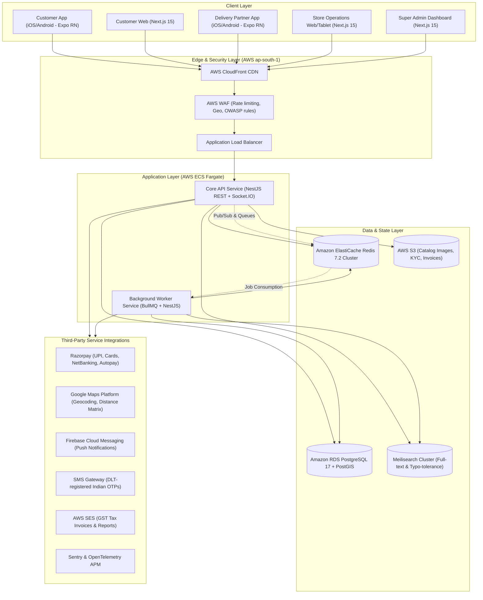
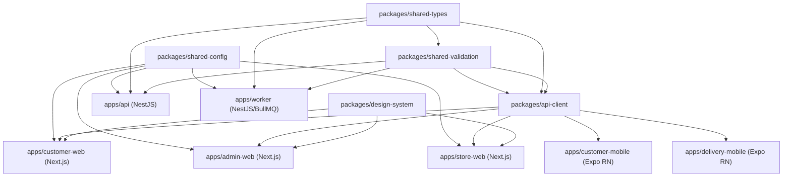
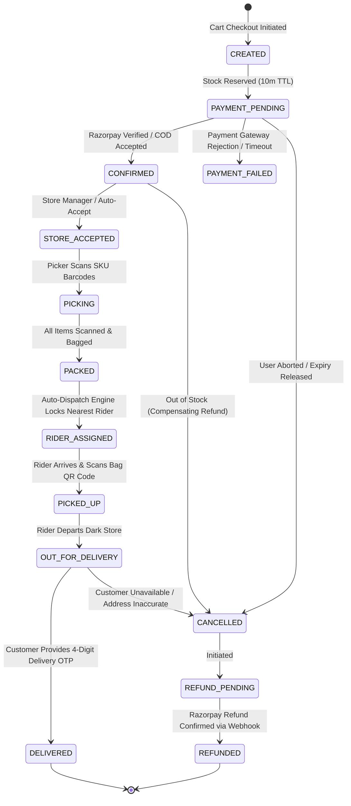

# SYSTEM ARCHITECTURE SPECIFICATION
## Project: Own-Inventory Quick Commerce Platform (Zepto/Blinkit Model)
### Initial Market: Noida / Delhi NCR, India | Multi-City Expansion Ready

---

## 1. Executive Summary & Business Model

The Quick Commerce Platform is a vertically integrated, own-inventory rapid fulfillment platform designed to deliver groceries, fresh produce, daily essentials, and FMCG items within 10 to 15 minutes.

Unlike a multi-vendor marketplace (e.g., Swiggy Instamart marketplace model, Amazon, or Zomato dining), this platform:
1. **Owns 100% of the physical inventory**: Stock is purchased directly from FMCG brands, authorized distributors, and local agricultural mandis, received into dark stores (micro-fulfillment centers or MFCs), and held on company balance sheets.
2. **Operates proprietary Dark Stores**: Stores are strategically located across high-density residential and commercial clusters in Noida (e.g., Sector 62, Sector 18, Sector 137, Greater Noida West).
3. **Controls Store Operations**: Direct staff (pickers, packers, store managers) are governed by strict SLAs (Picking SLA: <= 120s, Packing SLA: <= 60s, Staging & Handover SLA: <= 45s).
4. **Dispatches Dedicated Fleet**: Delivery partners (riders) operate under geofenced zones tied to specific dark stores with strict proximity dispatch and delivery OTP validation.

---

## 2. High-Level Architecture Diagram



---

## 3. Monorepo Structure & Package Dependency Topology

The monorepo uses **pnpm workspaces** and **Turborepo** for build caching, type-safe boundaries, and parallelization.



### Monorepo Directory Organization:
```
quick-commerce-platform/
├── apps/
│   ├── api/                    # NestJS Core API (REST + WebSocket Gateway)
│   ├── worker/                 # NestJS BullMQ Workers (Async workflows, expiry, dispatch)
│   ├── customer-web/           # Next.js 15 App Router Customer e-commerce portal
│   ├── admin-web/              # Next.js 15 Super Admin Management Console
│   ├── store-web/              # Next.js 15 Dark Store Picker/Packer/Manager Tablet App
│   ├── customer-mobile/        # Expo React Native customer shopping app
│   └── delivery-mobile/        # Expo React Native rider dispatch & delivery app
├── packages/
│   ├── shared-types/           # Shared TypeScript interfaces, DTOs, domain models, enums
│   ├── shared-validation/      # Zod schemas matching shared types for strict validation
│   ├── api-client/             # Generated typed fetch client with TanStack Query hooks
│   ├── design-system/          # Tailored Tailwind/shadcn component library
│   └── shared-config/          # Shared ESLint, Prettier, TypeScript, Tailwind configs
├── infrastructure/
│   ├── docker/                 # Production & Development multi-stage Dockerfiles
│   ├── aws/                    # ECS Task definitions, CloudWatch alerts, IAM roles
│   ├── terraform/              # Complete IaC for AWS ap-south-1 (VPC, RDS, Redis, ECS, ALB)
│   └── monitoring/             # Prometheus/Grafana dashboards, Sentry configuration
├── docs/                       # Architecture, DB, API, Security, Operations specs
└── scripts/                    # Database seeding, migration runners, CI deployment scripts
```

---

## 4. Core Subsystem Architectural Specifications

### 4.1 Dark Store Geospatial Selection Engine
To fulfill 10-15 minute delivery, dark store selection does **not** rely on naive Euclidean distance. Instead, it evaluates real-time operational capacity and PostGIS spatial boundaries:

```mermaid
flowchart TD
    A["Customer Enters Location (Lat, Lng)"] --> B["Spatial Zone Lookup (PostGIS ST_Contains)"]
    B -->|No Polygon Matches| C["Return: OUT_OF_SERVICE_ZONE"]
    B -->|Zone Found| D["Fetch Active Dark Stores in Zone"]
    D --> E{"Store Operational Checks"}
    E -->|Store Inactive or Operating Hours Closed| F["Filter Out Store"]
    E -->|Store Active| G{"Store Capacity Check"}
    G -->|Picking Backlog > Threshold (e.g. > 25 orders)| H["Mark Congested / Delay SLA"]
    G -->|Capacity Healthy| I{"Rider Fleet Availability"}
    I -->|Active Riders Available within 500m| J["Compute Dynamic ETA (Transit + Pick + Pack)"]
    I -->|Zero Riders Available| K["Fallback Store or Surge Delay Notice"]
    J --> L["Return Serviceable Store + Products Stock Status"]
```

- **Geospatial Model**: Dark stores have an explicit service polygon (`geometry(Polygon, 4326)`).
- **ETA Formula**: 
  $$\text{ETA} = T_{\text{accept}} (30\text{s}) + T_{\text{pick}} (120\text{s}) + T_{\text{pack}} (60\text{s}) + T_{\text{dispatch\_buffer}} (60\text{s}) + T_{\text{transit}}(\text{distance}, \text{traffic}) + T_{\text{dropoff}} (90\text{s})$$

### 4.2 High-Throughput Inventory Engine & FEFO Enforcement
Inventory accuracy is guaranteed through strict multi-level isolation:
1. **Physical Isolation**: Inventory is partitioned by `(storeId, productVariantId, batchId)`.
2. **First-Expiry-First-Out (FEFO)**: When products are reserved for picking, the batch with the earliest valid expiry date is assigned first.
3. **Atomic Stock Reservation**:
   - Stock reservation occurs during checkout using PostgreSQL `SELECT ... FOR UPDATE` with conditional decrement:
   ```sql
   UPDATE store_inventories
   SET available_quantity = available_quantity - $qty,
       reserved_quantity = reserved_quantity + $qty,
       updated_at = NOW()
   WHERE store_id = $storeId
     AND product_variant_id = $variantId
     AND available_quantity >= $qty;
   ```
4. **Reservation Expiry Engine**: If payment is not completed within 10 minutes (configurable via `SystemSetting`), BullMQ triggers `InventoryReservationExpiryWorker` to atomically release the reserved stock back to `available_quantity`.
5. **Compensating Stock Movements**: No row in `stock_movements` is ever deleted or mutated; all cancellations, supplier returns, or write-offs generate an immutable compensating journal record.

### 4.3 Order State Machine
The centralized order state machine enforces deterministic, auditable state transitions.



### 4.4 Automated Dispatch & Rider Assignment
- **Proximity Geohash**: Dark stores broadcast ready orders to online, active riders whose current GPS fix is within the dark store's geofenced radius.
- **Atomic Assignment Lock**: BullMQ dispatch job locks rider assignment with a 30-second acceptance timer in Redis (`SET order:lock:<orderId> <riderId> NX EX 30`).
- **Assignment Failover**: If the rider rejects or times out, the engine automatically selects the next closest ranked rider.
- **Verification Handshake**: Order handover requires scanning the physical tote/bag barcode; delivery completion strictly requires customer OTP matching.

### 4.5 Real-Time Communication Layer (Socket.IO)
- **Namespaces**:
  - `/orders`: Real-time order progress for customer and dark store screens.
  - `/tracking`: High-frequency rider coordinates (throttled to 3-second bursts, encrypted room).
  - `/store-ops`: Live incoming order queue and picker assignment board.
  - `/admin`: Real-time operational map, active fleet telematics, and GMV counters.
- **JWT Authorization**: All WebSocket handshakes validate the Bearer token and enforce room-level ownership checks (e.g., customer cannot join room `order:123` unless `order.customerId === user.id`).

---

## 5. Security & Compliance Architecture

1. **Authentication**:
   - Indian mobile number (+91) with 6-digit cryptographic OTP.
   - Argon2id password hashing for admin/store users.
   - Refresh token rotation with Redis fingerprinting and revocation blacklists.
2. **Indian Regulatory Compliance**:
   - **GST (Goods & Services Tax)**: Tiered GST rates (0%, 5%, 12%, 18%, 28%) with automatic HSN code determination and split CGST + SGST (intra-state) or IGST (inter-state).
   - **FSSAI Compliance**: Dark store FSSAI license numbers and FMCG product batch expiry dates printed on customer invoices.
   - **Legal Metrology**: Mandatory display of MRP, Net Quantity, Country of Origin, Expiry Date, and Consumer Care details on product detail screens.
3. **Financial Protection**:
   - Razorpay Webhook signature verification (`X-Razorpay-Signature` HMAC SHA256) with deduplication against `payment_webhook_events`.
   - All currency values stored in integer **paise** (1 INR = 100 paise) preventing IEEE-754 floating-point inaccuracies.

---

## 6. AWS Infrastructure & Deployment Topology

- **AWS Region**: `ap-south-1` (Mumbai) for minimum latency (< 20ms to Noida / Delhi NCR users).
- **VPC Subnets**:
  - Public Subnets (2x Multi-AZ): CloudFront, ALB, NAT Gateways.
  - Private App Subnets (2x Multi-AZ): ECS Fargate tasks (Core API & Workers).
  - Isolated Data Subnets (2x Multi-AZ): RDS PostgreSQL 17 Multi-AZ, ElastiCache Redis Cluster.
- **IaC**: Modular Terraform definitions in `infrastructure/terraform/` providing reproducible dev, staging, and production environments.
