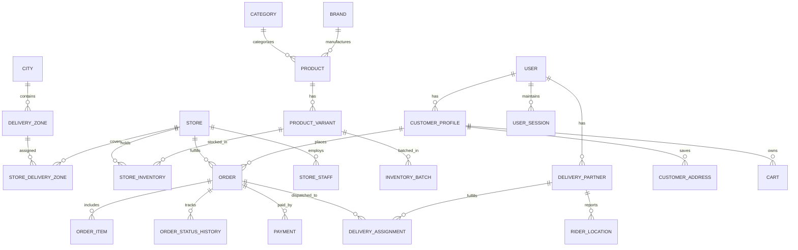

# DATABASE DESIGN SPECIFICATION
## Database Name: `quick_commerce_db`
### Engine: PostgreSQL 17 with PostGIS Extension
### Target Market: Noida / Delhi NCR, India (Own-Inventory Quick Commerce)

---

## 1. Design Principles & Hard Constraints

1. **Monetary Precision**: All currency values are stored as 64-bit BigInt (`BIGINT`) representing integer **paise** (1 INR = 100 paise; e.g., ₹249.50 = `24950`). Floating point types (`FLOAT`, `DOUBLE`) are strictly forbidden for financial calculations.
2. **Geospatial Processing**: PostGIS is enabled (`CREATE EXTENSION IF NOT EXISTS postgis;`). Store coordinates use `geography(Point, 4326)` for geodetic distance calculations; delivery zones use `geometry(Polygon, 4326)` or `geometry(MultiPolygon, 4326)` with spatial GiST indexing.
3. **SKU & Inventory Isolation**: Every `ProductVariant` has a globally unique `sku`. Stock is strictly isolated per store and batch: `(store_id, product_variant_id, batch_id)`.
4. **Order Immutability & Snapshots**: When an order is placed, full product name, variant attributes, HSN code, GST rate, unit price, and discount are snapshotted in `order_items`. Subsequent edits to catalog prices never affect historical orders.
5. **Auditability**: All state transitions (`order_status_histories`), stock movements (`stock_movements`), and administrative actions (`audit_logs`) are append-only.
6. **Concurrency & Locking**: Pessimistic row locking (`SELECT ... FOR UPDATE`) is used on inventory rows during checkout reservation. Reservations store strict expiration timestamps (`expires_at`).
7. **Idempotency**: All payment events, order submissions, and webhook deliveries include unique idempotency keys and provider event IDs.

---

## 2. Complete Entity-Relationship (ER) Schema Overview

---

## 3. Detailed Domain Model Specifications

### Domain A: Identity & Access Control
1. **`users`**:
   - `id`: UUID Primary Key (`gen_random_uuid()`)
   - `phone`: VARCHAR(15) UNIQUE (E.164 format, e.g., `+919876543210`)
   - `email`: VARCHAR(255) UNIQUE NULLABLE
   - `password_hash`: VARCHAR(255) NULLABLE (Argon2id, for staff/admin)
   - `is_active`: BOOLEAN DEFAULT true
   - `is_phone_verified`: BOOLEAN DEFAULT false
   - `created_at`, `updated_at`: TIMESTAMPTZ
2. **`user_sessions`**:
   - `id`: UUID PK
   - `user_id`: UUID FK -> `users(id)` ON DELETE CASCADE
   - `refresh_token_hash`: VARCHAR(255) NOT NULL
   - `ip_address`: VARCHAR(45)
   - `user_agent`: TEXT
   - `expires_at`: TIMESTAMPTZ NOT NULL
   - `revoked_at`: TIMESTAMPTZ NULLABLE
3. **`otp_verifications`**:
   - `id`: UUID PK
   - `phone`: VARCHAR(15) NOT NULL
   - `otp_hash`: VARCHAR(255) NOT NULL
   - `purpose`: ENUM (`LOGIN`, `REGISTRATION`, `CHECKOUT`, `DELIVERY_VERIFICATION`)
   - `attempts`: INTEGER DEFAULT 0
   - `expires_at`: TIMESTAMPTZ NOT NULL
   - `verified_at`: TIMESTAMPTZ NULLABLE
   - Index on `(phone, purpose, expires_at)`
4. **`roles`**, **`permissions`**, **`user_roles`**, **`role_permissions`**:
   - Standard RBAC hierarchy: `SUPER_ADMIN`, `CITY_MANAGER`, `STORE_MANAGER`, `STORE_PICKER`, `STORE_PACKER`, `RIDER`, `CUSTOMER`, `SUPPORT_AGENT`.
5. **`audit_logs`**:
   - `id`: UUID PK, `user_id`: UUID NULLABLE, `action`: VARCHAR(100), `entity`: VARCHAR(100), `entity_id`: VARCHAR(100), `old_values`: JSONB, `new_values`: JSONB, `ip_address`: VARCHAR(45), `created_at`: TIMESTAMPTZ.

### Domain B: Customers
1. **`customer_profiles`**:
   - `id`: UUID PK, `user_id`: UUID UNIQUE FK -> `users(id)`
   - `first_name`: VARCHAR(100), `last_name`: VARCHAR(100)
   - `loyalty_points`: INTEGER DEFAULT 0
   - `wallet_balance_paise`: BIGINT DEFAULT 0
2. **`customer_addresses`**:
   - `id`: UUID PK, `customer_id`: UUID FK -> `customer_profiles(id)`
   - `address_type`: ENUM (`HOME`, `WORK`, `OTHER`)
   - `recipient_name`: VARCHAR(100), `recipient_phone`: VARCHAR(15)
   - `apartment_flat`: VARCHAR(255)
   - `street_address`: TEXT
   - `landmark`: VARCHAR(255)
   - `city`: VARCHAR(100) DEFAULT 'Noida'
   - `state`: VARCHAR(100) DEFAULT 'Uttar Pradesh'
   - `pincode`: VARCHAR(10) NOT NULL
   - `coordinates`: `geography(Point, 4326)` NOT NULL (GiST Indexed)
   - `is_default`: BOOLEAN DEFAULT false
3. **`devices`**: Push notification tokens (FCM) mapped to user IDs.
4. **`customer_preferences`**: Key-value JSONB flags for marketing, SMS, WhatsApp alerts.

### Domain C: Geography & Serviceability
1. **`cities`**:
   - `id`: UUID PK, `name`: VARCHAR(100) UNIQUE (e.g. 'Noida'), `state`: VARCHAR(100) ('Uttar Pradesh'), `is_active`: BOOLEAN DEFAULT true.
2. **`delivery_zones`**:
   - `id`: UUID PK, `city_id`: UUID FK -> `cities(id)`
   - `name`: VARCHAR(100) (e.g., 'Noida Sector 62 & Indirapuram Boundary')
   - `boundary`: `geometry(Polygon, 4326)` NOT NULL (GiST Indexed)
   - `is_active`: BOOLEAN DEFAULT true
3. **`store_delivery_zones`**:
   - Links a `store_id` to a `delivery_zone_id` with priority ranking and max delivery SLA (in minutes).

### Domain D: Stores (Dark Stores / MFCs)
1. **`stores`**:
   - `id`: UUID PK, `code`: VARCHAR(50) UNIQUE (e.g., 'MFC-NOIDA-SEC62')
   - `name`: VARCHAR(150), `address`: TEXT, `city_id`: UUID FK
   - `fssai_license_number`: VARCHAR(50) NOT NULL (Mandatory for food safety)
   - `gstin`: VARCHAR(15) NOT NULL (Goods and Services Tax ID)
   - `location`: `geography(Point, 4326)` NOT NULL (GiST Indexed)
   - `is_active`: BOOLEAN DEFAULT true
   - `max_active_orders_capacity`: INTEGER DEFAULT 50
   - `current_picking_orders_count`: INTEGER DEFAULT 0
2. **`store_operating_hours`**: Day of week (0-6), open time, close time, is_closed.
3. **`store_staff`**: Maps store users to roles (Store Manager, Picker, Packer).
4. **`store_shelves`**: Aisle, Rack, Shelf, Bin naming for rapid picking route guidance.
5. **`store_holidays`**: Ad-hoc holiday closures or emergency maintenance closures.

### Domain E: Catalog & Indian Tax Rules
1. **`categories`**:
   - `id`: UUID PK, `name`: VARCHAR(100), `slug`: VARCHAR(120) UNIQUE
   - `parent_id`: UUID NULLABLE FK -> `categories(id)`
   - `image_url`: TEXT, `display_order`: INTEGER DEFAULT 0, `is_active`: BOOLEAN DEFAULT true
2. **`brands`**:
   - `id`: UUID PK, `name`: VARCHAR(100) UNIQUE, `logo_url`: TEXT, `is_active`: BOOLEAN DEFAULT true
3. **`products`**:
   - `id`: UUID PK, `name`: VARCHAR(255), `slug`: VARCHAR(280) UNIQUE
   - `category_id`: UUID FK, `brand_id`: UUID FK
   - `description`: TEXT, `country_of_origin`: VARCHAR(100) DEFAULT 'India'
   - `fssai_category`: VARCHAR(100) NULLABLE
   - `hsn_code`: VARCHAR(20) NOT NULL (e.g., '0401' for Milk, '1006' for Rice)
   - `is_active`: BOOLEAN DEFAULT true
4. **`product_variants`**:
   - `id`: UUID PK, `product_id`: UUID FK
   - `sku`: VARCHAR(100) UNIQUE NOT NULL (e.g., 'AMUL-TAZA-500ML')
   - `barcode`: VARCHAR(100) UNIQUE NOT NULL (UPC/EAN-13 for barcode scanner)
   - `unit_quantity`: DECIMAL(10, 3) (e.g., 500.000)
   - `unit_of_measure`: VARCHAR(20) (e.g., 'ml', 'g', 'kg', 'piece')
   - `mrp_paise`: BIGINT NOT NULL (Maximum Retail Price in paise)
   - `selling_price_paise`: BIGINT NOT NULL (Base selling price in paise)
   - `tax_rate_percent`: DECIMAL(5, 2) NOT NULL (e.g., 5.00, 18.00)
   - `weight_grams`: INTEGER NOT NULL (Used for rider payload calculations)
5. **`product_images`**: Variant images with display priority.

### Domain F: Inventory & FEFO Batch Management
1. **`store_inventories`**:
   - `id`: UUID PK
   - `store_id`: UUID FK -> `stores(id)`
   - `product_variant_id`: UUID FK -> `product_variants(id)`
   - `available_quantity`: INTEGER NOT NULL DEFAULT 0 CHECK (`available_quantity` >= 0)
   - `reserved_quantity`: INTEGER NOT NULL DEFAULT 0 CHECK (`reserved_quantity` >= 0)
   - `damaged_quantity`: INTEGER NOT NULL DEFAULT 0 CHECK (`damaged_quantity` >= 0)
   - `low_stock_threshold`: INTEGER NOT NULL DEFAULT 5
   - UNIQUE(`store_id`, `product_variant_id`)
2. **`inventory_batches`**:
   - `id`: UUID PK
   - `store_inventory_id`: UUID FK -> `store_inventories(id)`
   - `batch_number`: VARCHAR(100) NOT NULL
   - `manufacturing_date`: DATE NOT NULL
   - `expiry_date`: DATE NOT NULL
   - `quantity`: INTEGER NOT NULL CHECK (`quantity` >= 0)
   - Index on `(store_inventory_id, expiry_date ASC)` for FEFO allocation.
3. **`stock_reservations`**:
   - `id`: UUID PK, `order_id`: UUID NULLABLE, `checkout_session_id`: VARCHAR(100)
   - `store_id`: UUID FK, `product_variant_id`: UUID FK, `quantity`: INTEGER
   - `status`: ENUM (`PENDING`, `CONFIRMED`, `EXPIRED`, `CANCELLED`)
   - `expires_at`: TIMESTAMPTZ NOT NULL
4. **`stock_movements`**:
   - Immutable audit ledger: `id`, `store_id`, `product_variant_id`, `batch_id`, `quantity_delta`, `type` (`PROCUREMENT`, `CUSTOMER_ORDER`, `RESERVATION_RELEASE`, `DAMAGED_WRITE_OFF`, `AUDIT_CORRECTION`), `reference_id`, `created_at`.
5. **`stock_adjustments`**, **`stock_counts`**, **`stock_count_items`**: Physical stock reconciliation.

### Domain G: Procurement & Inwarding
1. **`suppliers`**: FMCG vendors and distributors with GSTIN, PAN, Bank Details, Contact.
2. **`purchase_orders`**, **`purchase_order_items`**: POs raised by store or central warehouse.
3. **`goods_receipts`**, **`goods_receipt_items`**: Physical delivery verification, barcode verification, expiry logging, and batch allocation into dark store inventory.

### Domain H: Shopping & Checkout
1. **`carts`**, **`cart_items`**: Ephemeral customer carts tied to `customer_id` and `store_id`.
2. **`checkout_sessions`**:
   - `id`: UUID PK
   - `customer_id`: UUID FK
   - `store_id`: UUID FK
   - `address_id`: UUID FK
   - `idempotency_key`: VARCHAR(100) UNIQUE NOT NULL
   - `expires_at`: TIMESTAMPTZ NOT NULL
3. **`checkout_price_snapshots`**: Frozen breakdown of item totals, delivery charges, packaging fees, tip, discounts, and GST breakdown.

### Domain I: Orders & Fulfillment
1. **`orders`**:
   - `id`: UUID PK
   - `order_number`: VARCHAR(30) UNIQUE NOT NULL (e.g., `ORD-20261111-0001`)
   - `customer_id`: UUID FK -> `customer_profiles(id)`
   - `store_id`: UUID FK -> `stores(id)`
   - `status`: OrderStatus ENUM (14 statuses, see Section 4.3 of Architecture)
   - `delivery_address_snapshot`: JSONB NOT NULL
   - `subtotal_paise`: BIGINT NOT NULL
   - `tax_paise`: BIGINT NOT NULL
   - `delivery_fee_paise`: BIGINT NOT NULL
   - `tip_paise`: BIGINT DEFAULT 0
   - `discount_paise`: BIGINT DEFAULT 0
   - `total_paise`: BIGINT NOT NULL
   - `delivery_otp_hash`: VARCHAR(255) NOT NULL (4-digit OTP for rider completion)
   - `estimated_delivery_time`: TIMESTAMPTZ NOT NULL
   - `delivered_at`: TIMESTAMPTZ NULLABLE
   - `created_at`, `updated_at`: TIMESTAMPTZ NOT NULL
2. **`order_items`**:
   - `id`: UUID PK, `order_id`: UUID FK -> `orders(id)`
   - `product_variant_id`: UUID FK
   - `batch_id`: UUID FK NULLABLE
   - `product_name`: VARCHAR(255) NOT NULL (Snapshot)
   - `variant_title`: VARCHAR(100) NOT NULL (Snapshot)
   - `sku`: VARCHAR(100) NOT NULL (Snapshot)
   - `hsn_code`: VARCHAR(20) NOT NULL (Snapshot)
   - `tax_rate_percent`: DECIMAL(5, 2) NOT NULL (Snapshot)
   - `unit_price_paise`: BIGINT NOT NULL (Snapshot)
   - `quantity`: INTEGER NOT NULL
   - `total_price_paise`: BIGINT NOT NULL
   - `picking_status`: ENUM (`PENDING`, `PICKED`, `OUT_OF_STOCK`, `SUBSTITUTED`)
3. **`order_status_histories`**:
   - `id`: UUID PK, `order_id`: UUID FK, `from_status`: OrderStatus, `to_status`: OrderStatus, `changed_by_user_id`: UUID NULLABLE, `reason`: TEXT, `created_at`: TIMESTAMPTZ.
4. **`order_invoices`**:
   - GST compliant serial invoice (`INV-NOIDA-YYYYMM-XXXXX`), B2C QR code, CGST/SGST/IGST breakups, FSSAI numbers.

### Domain J: Finance & Payments
1. **`payments`**:
   - `id`: UUID PK, `order_id`: UUID FK -> `orders(id)`
   - `payment_method`: ENUM (`RAZORPAY_UPI`, `RAZORPAY_CARD`, `RAZORPAY_NETBANKING`, `COD`)
   - `gateway_order_id`: VARCHAR(100) (Razorpay `order_id`)
   - `gateway_payment_id`: VARCHAR(100) UNIQUE NULLABLE (Razorpay `payment_id`)
   - `gateway_signature`: VARCHAR(255) NULLABLE
   - `amount_paise`: BIGINT NOT NULL
   - `status`: ENUM (`PENDING`, `AUTHORIZED`, `CAPTURED`, `FAILED`, `REFUNDED`)
2. **`payment_webhook_events`**:
   - `id`: UUID PK, `provider`: VARCHAR(50) DEFAULT 'RAZORPAY'
   - `event_id`: VARCHAR(100) UNIQUE NOT NULL (Razorpay `x-razorpay-event-id`)
   - `event_type`: VARCHAR(100) NOT NULL
   - `payload`: JSONB NOT NULL, `processed_at`: TIMESTAMPTZ
3. **`refunds`**:
   - `id`: UUID PK, `payment_id`: UUID FK, `gateway_refund_id`: VARCHAR(100) UNIQUE, `amount_paise`: BIGINT, `status`: ENUM (`PENDING`, `PROCESSED`, `FAILED`).
4. **`cash_collections`**: Tracking physical cash collected by delivery partners for COD orders with reconciliation lock.

### Domain K: Delivery & Fleet
1. **`delivery_partners`**:
   - `id`: UUID PK, `user_id`: UUID UNIQUE FK -> `users(id)`
   - `current_store_id`: UUID FK NULLABLE -> `stores(id)`
   - `status`: ENUM (`OFFLINE`, `AVAILABLE`, `ASSIGNED`, `ON_DELIVERY`)
   - `current_location`: `geography(Point, 4326)` NULLABLE (GiST Indexed)
   - `last_ping_at`: TIMESTAMPTZ NULLABLE
   - `is_verified`: BOOLEAN DEFAULT false
2. **`rider_documents`**: Driving License, Aadhaar Card, PAN Card, Vehicle RC verification.
3. **`delivery_assignments`**:
   - `id`: UUID PK, `order_id`: UUID FK -> `orders(id)`
   - `rider_id`: UUID FK -> `delivery_partners(id)`
   - `status`: ENUM (`OFFERED`, `ACCEPTED`, `REJECTED`, `TIMEOUT`, `COMPLETED`, `CANCELLED`)
   - `assigned_at`, `accepted_at`, `picked_up_at`, `delivered_at`: TIMESTAMPTZ
   - CONSTRAINT: `UNIQUE(order_id, status)` where status IN ('OFFERED', 'ACCEPTED')
4. **`rider_earnings`**: Base pay, peak surge bonus, tips, fuel allowance per order.

### Domains L to O: Promotions, Support, Reliability, Analytics
- **Promotions**: `coupons`, `coupon_redemptions`, `promotions`.
- **Support**: `support_tickets`, `support_messages`, `notifications`.
- **Reliability**: `transactional_outbox` (guaranteed message delivery to RabbitMQ/Kafka/BullMQ), `idempotency_records` (distributed deduplication locks).
- **Analytics**: `analytics_daily_stores`, `analytics_daily_products`, `demand_forecasts`.
