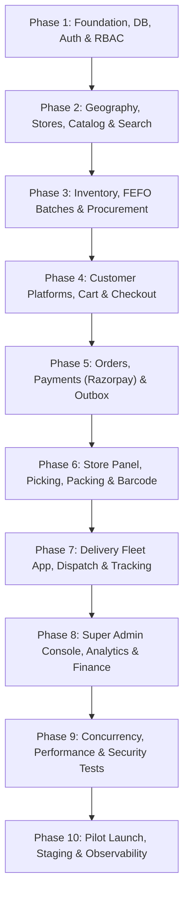

# IMPLEMENTATION ROADMAP & EXECUTION PLAN
## Project: Own-Inventory Quick Commerce Platform (Zepto/Blinkit Architecture)
### Target Launch Market: Noida / Delhi NCR, India

---

## 1. Overview & Phased Methodology

To ensure architectural integrity, zero technical debt, and production readiness, execution is divided into 10 structured phases. Work progresses strictly in dependency order, validating every milestone with type-checks, migrations, integration tests, and operational verification before advancing.

---

## 2. Phase-by-Phase Breakdown

### Phase 1: Repository, Architecture, Infrastructure, Database, Authentication, RBAC
- **Milestone 1.1**: Monorepo workspace configuration (`pnpm`, `turborepo`, shared packages).
- **Milestone 1.2**: Complete Prisma Schema with all 15 domains, enums, indexes, and PostGIS types.
- **Milestone 1.3**: Initial database migrations generated and executed on PostgreSQL 17.
- **Milestone 1.4**: Core API NestJS scaffolding with Swagger, PrismaService, RedisService.
- **Milestone 1.5**: Indian Phone Number (+91) OTP authentication engine with rate limiting & Redis TTL.
- **Milestone 1.6**: Staff/Admin Argon2id password authentication with Refresh Token rotation.
- **Milestone 1.7**: Granular RBAC guards, permissions decorator, and audit logging interceptor.
- **Verification**: Unit & integration tests for Auth, Session lifecycle, RBAC enforcement.

### Phase 2: Geography, Dark Stores, Product Catalog & Search Engine
- **Milestone 2.1**: Indian Geography models: Noida sectors, geofenced `delivery_zones` with PostGIS boundaries.
- **Milestone 2.2**: Dark store MFC configuration (FSSAI licenses, GSTIN, operating hours, capacity limits).
- **Milestone 2.3**: Geospatial serviceability lookup API (`ST_Contains`, `ST_Distance`).
- **Milestone 2.4**: Multi-tier Catalog Management (Categories, Brands, Products, Variants with HSN and GST).
- **Milestone 2.5**: Meilisearch search synchronization worker with Indian grocery typo-tolerance.
- **Verification**: Geocoding tests, polygon containment tests, catalog CRUD tests.

### Phase 3: Inventory Engine, FEFO Batches, Procurement & Reservations
- **Milestone 3.1**: Store inventory isolation by `(store_id, product_variant_id)`.
- **Milestone 3.2**: Batch tracking with manufacturing dates, expiry dates, and FEFO picker allocation.
- **Milestone 3.3**: Atomic stock reservation API with pessimistic row locks (`SELECT ... FOR UPDATE`).
- **Milestone 3.4**: BullMQ worker for automatic reservation expiration after 10-minute timeout.
- **Milestone 3.5**: Inwarding & Procurement workflows (Purchase Orders, Goods Receipts, GRN barcode scanning).
- **Verification**: Automated concurrent reservation tests (race condition prevention).

### Phase 4: Customer Mobile App (Expo), Customer Web (Next.js 15), Cart & Checkout
- **Milestone 4.1**: Customer Web application (Next.js 15 App Router, Tailwind, shadcn/ui).
- **Milestone 4.2**: Customer Mobile application (React Native, Expo Router, NativeWind).
- **Milestone 4.3**: Location detection (GPS, Noida Sector picker, reverse geocoding, saved addresses).
- **Milestone 4.4**: Dynamic catalog browsing, instant category switching, search suggestions.
- **Milestone 4.5**: Ephemeral Cart, coupon application engine, and instant price breakdown in paise.
- **Verification**: End-to-end cart recalculation, tax and delivery fee snapshots.

### Phase 5: Centralized Order Engine, Razorpay Integration & Notifications
- **Milestone 5.1**: 14-state Order State Machine with transition guards and transactional outbox.
- **Milestone 5.2**: Razorpay backend order generation, webhook verification, signature validation.
- **Milestone 5.3**: Cash on Delivery (COD) flow with OTP verification and fraud checks.
- **Milestone 5.4**: Automated refund processing via Razorpay Refund API.
- **Milestone 5.5**: GST Invoice generation with HSN split and FSSAI registration details.
- **Milestone 5.6**: FCM and SMS notification workers for order updates.
- **Verification**: Webhook deduplication tests, payment signature verification tests.

### Phase 6: Dark Store Management Dashboard (Tablet & Web)
- **Milestone 6.1**: Live Incoming Orders kanban board with audio alerts and SLA countdown.
- **Milestone 6.2**: Digital Pick List with shelf/rack sorting and barcode validation (EAN-13 / UPC).
- **Milestone 6.3**: Out-of-stock reporting and customer-approved substitution protocol.
- **Milestone 6.4**: Packing verification, security bag sealing, and staging shelf assignment.
- **Milestone 6.5**: Store stock adjustments, FEFO expiry alerts, and cycle counting.
- **Verification**: Picker workflow simulation, barcode scanning reconciliation tests.

### Phase 7: Delivery Partner Mobile App (Expo RN) & Automated Dispatch
- **Milestone 7.1**: Rider application (Expo React Native, Expo SecureStore, Background Geolocation).
- **Milestone 7.2**: Automated Dispatch Engine: Nearest idle rider selection within dark store geofence.
- **Milestone 7.3**: 30-second assignment lock, accept/reject, and automated failover dispatch.
- **Milestone 7.4**: Turn-by-turn navigation deep-links (Google Maps / Mapbox).
- **Milestone 7.5**: Order handover barcode scanning and customer 4-digit Delivery OTP completion.
- **Milestone 7.6**: Real-time Socket.IO rider tracking with 3-second coordinate throttling.
- **Verification**: Dispatch failover tests, OTP validation, privacy geofence checks.

### Phase 8: Super Admin Dashboard, Financial Reconciliation & Analytics
- **Milestone 8.1**: Executive Command Center (Live GMV, Noida sector heatmaps, SLA breaches).
- **Milestone 8.2**: Dark store network control, capacity toggles, emergency surge controls.
- **Milestone 8.3**: Catalog, pricing, and discount rule management.
- **Milestone 8.4**: Financial settlement ledger, COD reconciliation, and GST tax export reports.
- **Milestone 8.5**: Rider fleet management, payouts, shifts, and document KYC approval.
- **Verification**: Financial export audit checks, RBAC permission barrier checks.

### Phase 9: Comprehensive Testing, Concurrency, Security & UAT
- **Milestone 9.1**: High-concurrency flash sale simulation (1,000 customers booking 5 units of stock).
- **Milestone 9.2**: Network drop and webhook replay resilience tests.
- **Milestone 9.3**: OWASP Top 10 penetration testing and dependency security scanning.
- **Milestone 9.4**: End-to-end Playwright tests spanning Customer -> Store -> Rider -> Admin.
- **Verification**: Zero overselling, 100% idempotency, sub-200ms p95 API response times.

### Phase 10: Cloud Infrastructure, Staging, Pilot Launch & Monitoring
- **Milestone 10.1**: AWS ap-south-1 ECS Fargate and RDS/ElastiCache provisioning via Terraform.
- **Milestone 10.2**: Docker multi-stage images pushed to AWS ECR with GitHub Actions CI/CD.
- **Milestone 10.3**: CloudWatch Alarms, Sentry error tracking, and OpenTelemetry tracing.
- **Milestone 10.4**: Controlled pilot launch in Noida Sector 62 & 137.
- **Milestone 10.5**: Operational playbooks, disaster recovery, and automated DB backup verification.
